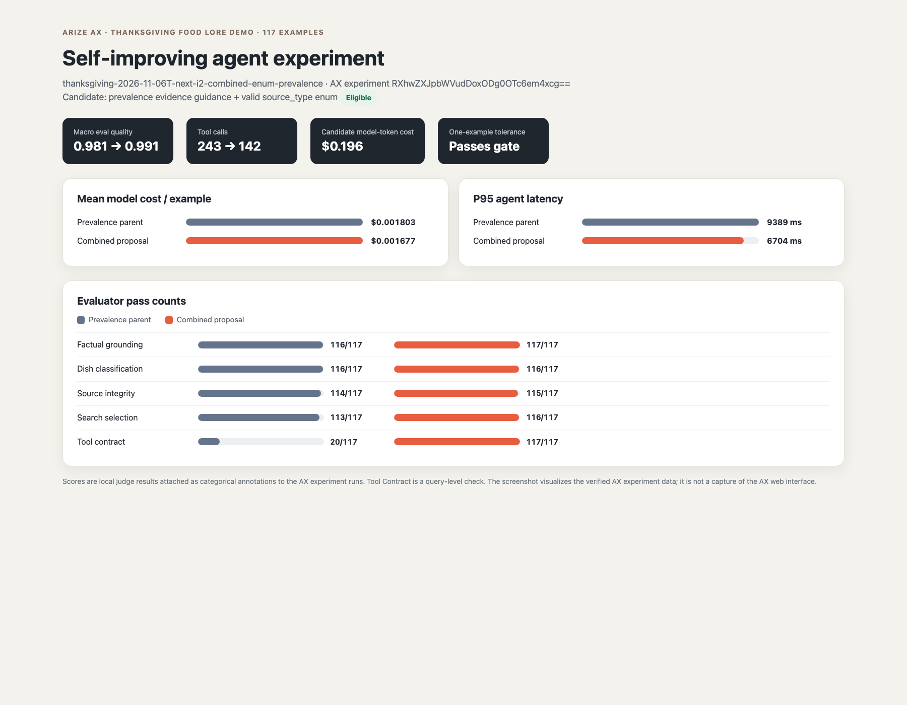

# Thanksgiving agent: final combined proposal

## Recommendation

Promote the combination of prevalence-evidence guidance and a valid source_type enum. It is the only candidate in this iteration that passes the one-example-per-evaluator tolerance, quality-improvement threshold, and cost/latency guardrails. It changes the agent prompt and tool schema; the patch is included alongside the experiment results.

## Experiment

- Dataset: thanksgiving-food-lore-traces-v1, pinned version RGF0YXNldFZlcnNpb246NDAyNjcxOi9FTzY=
- Size: 117 examples
- Final candidate AX experiment: thanksgiving-2026-11-06T-next-i2-combined-enum-prevalence (ID RXhwZXJpbWVudDoxODg0OTc6em4xcg==)
- Comparison parent AX experiment: thanksgiving-2026-11-06T-distinct-prevalence-candidate (ID RXhwZXJpbWVudDoxODgyNzU6K1A0Qg==)
- Scoring: four local LLM judges plus query-level Tool Contract code check. Labels were attached as categorical annotations to AX experiment runs.
- Acceptance: allow at most one additional failing example per evaluator; require aggregate improvement beyond one-label resolution; mean cost and p95 latency must remain within 10% of baseline and current best.

## Results

| Version | Factual | Dish | Source | Search | Tool contract | Macro quality | Mean cost/example | P95 ms | Tool calls | Decision |
|---|---:|---:|---:|---:|---:|---:|---:|---:|---:|---|
| Original baseline | 115/117 | 117/117 | 111/117 | 97/117 | 0/117 | 0.940 | $0.001836 | 9101 | 257 | reference |
| Prevalence parent | 116/117 | 116/117 | 114/117 | 113/117 | 20/117 | 0.981 | $0.001803 | 9389 | 243 | accepted parent |
| Combined final proposal | 117/117 | 116/117 | 115/117 | 116/117 | 117/117 | 0.991 | $0.001677 | 6704 | 142 | eligible |

The combined candidate improves macro quality from 0.981 to 0.991 versus the prevalence parent. Factual grounding increases by one pass, dish classification is unchanged at 116/117, source integrity increases by one pass, search selection increases by three passes, and Tool Contract improves from 20/117 to 117/117. Tool calls drop from 243 to 142; estimated mean token cost decreases from $0.001803 to $0.001677 per example; p95 latency falls from 9389 ms to 6704 ms.

The dish-classification score is one pass below the original baseline (116/117 vs. 117/117), within the approved tolerance.

## Other proposals

- **Historical-claim grounding** — rejected: factual grounding and dish classification each dropped by three examples relative to the prevalence parent. Experiment: thanksgiving-2026-11-06T-next-i2-ground-history-claims (ID RXhwZXJpbWVudDoxODg1MjE6QUlSeQ==).
- **Selective search** — rejected: source integrity dropped by three examples; it also did not reduce tool calls (273 vs. 243 for the prevalence parent). Twenty-seven rows did not call a tool, so Tool Contract was not applicable on those rows. Experiment: thanksgiving-2026-11-06T-next-i2-selective-search (ID RXhwZXJpbWVudDoxODg1Mzg6am5icA==).

All three candidate experiment runs and their per-evaluator annotations are retained in AX. Per-candidate outputs, scores, patches, and rejection reasons are included in this report directory.

## Experiment screenshot

This PNG is rendered from the verified AX experiment data and annotations. It visualizes the experiment metrics; it is not a browser capture of the AX interface. The source dashboard is experiment-dashboard.html.

Estimated model-token cost for the three candidate batches: $0.62746. Codex SDK patch-generation usage is separately metered and not included.
